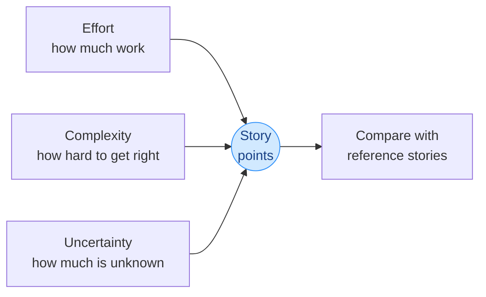
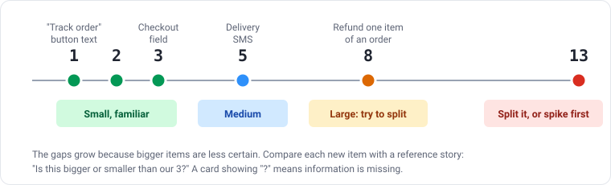
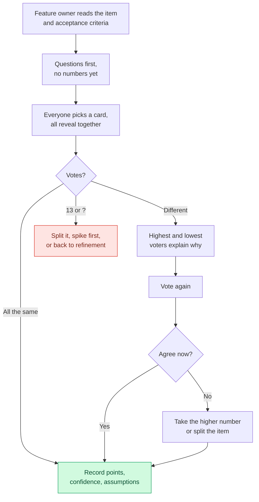
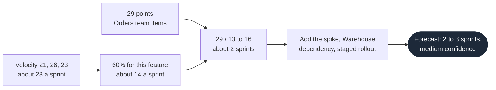

# Estimation and planning guidelines

## What estimates mean

An estimate is a team's assessment of relative effort and uncertainty. It is not a promise of an exact completion date and should not be used to compare individual performance.

## Recommended approach

1. Break the work into independently testable deliverables before estimating; see [Splitting work](SPLITTING_WORK.md).
2. Estimate with the people who will perform the work and understand the relevant system.
3. Use the team's established scale and reference stories. If the team has none yet, start with the scale and reference stories below.
4. Include implementation, code review, testing, integration and necessary documentation in the estimate.
5. Estimate spikes separately and state the question they are intended to answer.
6. Keep unknown dependencies visible; do not hide uncertainty inside an optimistic number.
7. Use ranges or confidence labels for early planning if the team has insufficient detail.
8. Re-estimate when scope or technical understanding materially changes, and record why.

## How story points are decided

### What a point measures

A story point compares one item with another. It combines three things:

- **Effort:** how much work there is.
- **Complexity:** how hard it is to get right, for example money, concurrency or many states.
- **Uncertainty:** how much the team doesn't know yet, for example a new library or an unfamiliar vendor API.

Points are not hours. A 5 is roughly twice the work and risk of a 2 or 3; it is not "five hours" or "five days".

### The scale

A common scale is **1, 2, 3, 5, 8, 13**. The gaps grow because bigger items are less certain, and arguing over 6 versus 7 wastes time.

| Points | Means |
|---|---|
| 1 | Tiny and well understood |
| 2 to 3 | Small, a familiar pattern |
| 5 | Medium, several parts or some unknowns |
| 8 | Large, with real complexity or risk; consider splitting |
| 13 | Too big or too uncertain for one sprint: split it, or run a spike first |
| ? | Can't estimate; something is missing, so send the item back to refinement |

Time-box spikes (for example "one day") instead of pointing them; their output is an answer, not a feature.

### Reference stories

Pick three or four finished items the whole team remembers, and estimate new items by comparing with them: "Is this bigger or smaller than our 3?" Example reference stories for an online store team:

| Points | Reference item | Why that size |
|---|---|---|
| 1 | Change the text and colour of the "Track order" button | One component, no logic, one test |
| 3 | Add a "delivery instructions" field at checkout, saved with the order | UI, an API field and a nullable column, all familiar patterns |
| 5 | Send an SMS when an order is out for delivery | A new event consumer, a third-party SMS API, retries and translations |
| 8 | Refund one item of a multi-item order | Money logic, rounding, a provider API and many edge cases |

Review the reference stories every few months; as the codebase changes, a "3" can quietly become a "2".

### Planning poker, step by step

1. The feature owner reads the item and its acceptance criteria aloud.
2. The team asks questions. Nobody says a number yet.
3. Everyone picks a card privately and all reveal together, so nobody anchors on the most senior person.
4. If votes differ, the highest and lowest voters explain why. They usually saw something the others missed.
5. Vote once more. If votes still differ, take the higher number or split the item. If one item takes more than about ten minutes, it isn't ready.
6. Record the points, confidence and any assumptions in the Delivery Plan.

The people who will build and test the item vote: developers and QA. The product owner answers questions but does not vote.

### Real example: the Orders team estimates order cancellation

The Orders team estimates its items from the [Splitting work](SPLITTING_WORK.md) example for [RFC-101](../examples/rfc-101-customer-order-cancellation.md). Four people vote: three developers and one QA engineer.

| Item | First votes | What the discussion found | Final | Confidence |
|---|---|---|---|---|
| WB-01 Order columns and refunds table | 1, 2, 2, 2 | New nullable columns are instant on the 48 million row table; the refunds table is new but simple | 2 | High |
| WB-02 Refund queue, dead-letter queue and flag | 2, 2, 3, 2 | The Terraform queue module already exists, and the flag tool is already in use | 2 | High |
| WB-04 Cancel a cash-on-delivery order on web | 3, 5, 5, 8 | The 3 voter pictured a button. The 8 voter pointed out the row lock: packing can start while the customer confirms. Everyone agreed the lock belongs in this item. Re-vote: 5, 5, 5, 5 | 5 | Medium |
| WB-06 Prepaid orders refunded automatically | 5, 8, 8, 13 | The 13 voter had seen the payment provider's sandbox fail randomly. The team added a one-day spike to test the sandbox first, then re-voted 8, 8, 8, 8 | 8 | Medium |
| WB-07 Expired-window messages and safe retry | 3, 3, 5, 3 | The 5 voter didn't know the idempotency middleware already exists; it can be reused | 3 | High |
| WB-08 Same flow in the Android and iOS app | 5, 5, 5, 8 | The app shares the web hook, but QA covers two platforms and an app store release. Took 5, with the QA time noted as a risk | 5 | Medium |
| WB-09 Refund reconciler and monitors | 3, 3, 3, 3 | Agreed straight away | 3 | High |
| WB-13 Remove the flag and old code paths | 1, 1, 1, 1 | Agreed straight away | 1 | High |

**Orders team total: 29 points**, plus a one-day spike. Warehouse, Payments, Support, Localization and QA estimate their own items on their own scales. Don't add points across teams: one team's 3 is not another team's 3.

### From points to a forecast

Velocity is the number of points a team finished in recent sprints, counting only items that met the Definition of Done.

- The Orders team finished 21, 26 and 23 points in its last three two-week sprints: about 23 a sprint.
- About 40% of each sprint goes to support work and another feature, so this feature gets around 60%: about 14 points a sprint.
- 29 points at 13 to 16 points a sprint is about two sprints. Add the spike, the Warehouse dependency and the staged rollout, and the forecast is **two to three sprints, medium confidence**.

Give the forecast as a range with a confidence level, not a single date. Update it after each sprint as real progress replaces the estimate.

### Rules that keep points useful

- Points belong to the team. Never use them to compare people or teams.
- Don't convert points to hours. If you need hours, estimate in hours.
- An unfinished item counts zero this sprint; its points count in the sprint it is done.
- Don't re-point an item because it turned out harder than expected. Discuss it in the retrospective; re-estimate only if the scope changed.
- Decide once whether bugs and chores get points, and stay consistent so velocity stays comparable.

## Suggested planning fields

| Field | Meaning |
|---|---|
| Estimate | Team-agreed points, ideal days or other existing unit |
| Confidence | High / Medium / Low |
| Estimate owner | Team or role providing the estimate |
| Assumptions | Conditions on which the estimate depends |
| Dependencies | Work or decisions that may affect delivery |
| Estimate date | When the estimate was last reviewed |

## Avoid

- Assigning points with Rovo or another AI tool without team validation.
- Converting story points directly into hours or individual productivity rankings.
- Treating a business-requested deadline as an engineering commitment.
- Estimating unresolved discovery as if it were implementation.
- Adding contingency to every item without showing the underlying risk.

## Capacity and delivery dates

The team considers estimates alongside actual capacity, operational support, leave, other commitments, dependencies and delivery risk. Sprint assignment and forecast dates are agreed during the team's planning process, not during automated work-item generation.
