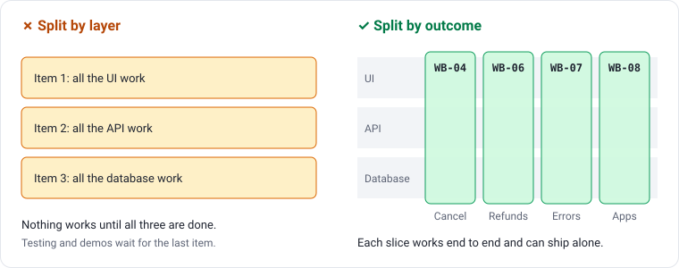
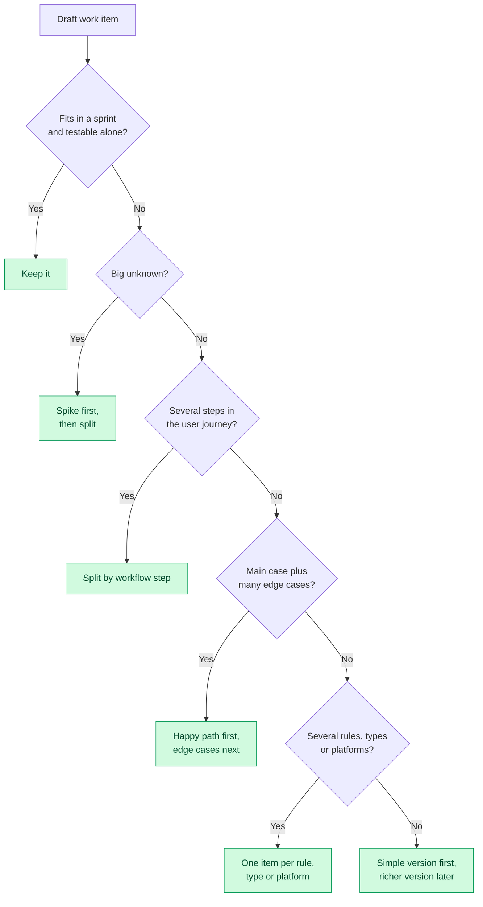
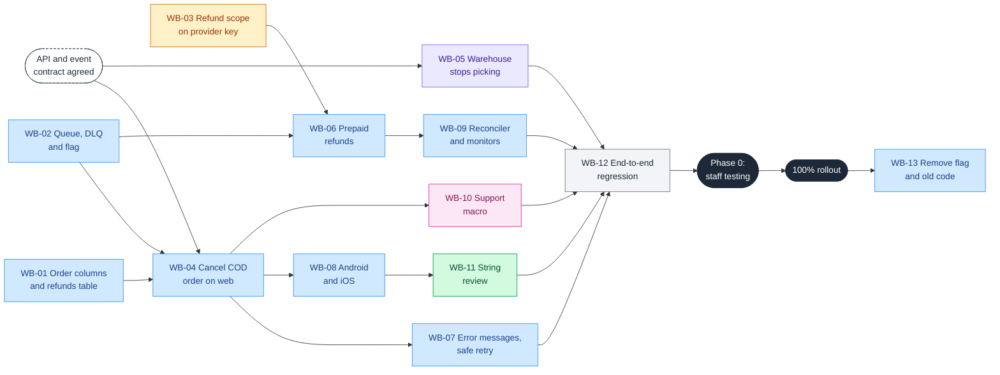

# Splitting work

How to turn an approved RFC into work items that teams can build, test and release in small, safe steps. The feature owner leads the split with the delivery teams during stage 5 (work breakdown). Each team estimates its own items; see [Estimation guidelines](ESTIMATION_GUIDELINES.md).

## What a good work item looks like

- **One outcome** that someone can see or check: a demo, a passing test, a metric, a deployed resource.
- **Small enough** for the team to finish and verify within one sprint, ideally in a few days.
- **Testable** acceptance criteria, written before work starts.
- **One owning team.**
- **Safe to release on its own**, behind a feature flag if the whole feature isn't ready.
- **Dependencies visible**, as Jira links rather than comments.

These match the story-level checks in the [Definition of Ready](DEFINITION_OF_READY.md).

## Factors to consider

Go through each factor when you draft the breakdown. Not every factor changes every split.

| Factor | Ask | What it means for the split |
|---|---|---|
| User value | Can someone see or check the result? | Slice through UI, API and data so each item works end to end. A "backend" item and a "frontend" item are useless alone when one team owns both. |
| Size | Can the team finish and verify it within a sprint? | If not, split it again with a pattern below. If an item is under half a day, merge it into a neighbour. |
| Team boundaries | Which team owns each part? | Give every item one owning team. Where work crosses teams, split at the boundary and agree the contract first (API schema, event payload), so both sides build in parallel against mocks. |
| Dependencies and order | What must exist before this can start? | Build foundations first: schema, queues, flag, contract. Then the slices. Record blockers as Jira links. |
| Risk and unknowns | What could prove the plan wrong? | Schedule the riskiest work first. Turn each open question into a time-boxed spike that answers one question. |
| Release safety | Can this go to production on its own? | Hide unfinished work behind a feature flag. Split risky data changes into expand, backfill, switch over and clean up. |
| Testing | How will we prove it works? | Tests belong in each item's acceptance criteria. Create separate QA items only for end-to-end, regression, load or accessibility runs that span several items. |
| Cross-cutting work | Which RFC sections apply: events (12), translations (13), monitors (14), security (11), docs? | Put them in the acceptance criteria of the item they belong to. Make separate items only when another team or vendor owns them, or they have a lead time. |
| Lead time outside the team | What waits on someone else: approvals, a vendor, app store review, legal text, translation review? | Start these early as their own items with a needed-by date. |
| Parallel work | How many people can work at once without blocking each other? | Split so items touch different screens or services. Three items changing the same screen at once cause conflicts and waiting. |
| Clean-up | What must be removed after launch? | Create items now for removing the flag, old code paths and old tables, so they don't get forgotten. |

## Splitting patterns

When an item is too big, walk through these questions, then use the matching pattern from the table. Check each new item the same way.

The patterns in detail. The examples split [RFC-101, customers cancel their own orders](../examples/rfc-101-customer-order-cancellation.md).

| Pattern | Split by | Example |
|---|---|---|
| Workflow steps | Each step of the user's journey | See the Cancel button and countdown · pick a reason and confirm · see the result |
| Happy path first | The main case, then edge cases and errors | Cancel an eligible order · then "window expired" and "packing started" messages · then retry on a poor network |
| Business rules | Each rule or variation | Cash-on-delivery orders (no refund) · then prepaid orders (automatic refund) |
| Platform | Each channel | Web first · then the Android and iOS app |
| Simple, then richer | A fixed version, then a configurable one | Fixed 30-minute window · a window per product category only if needed later |
| Defer optimisation | Correct first, faster later | Only when the simple version is safe at today's volume |
| Spike, then build | A time-boxed question, then the real items | A one-day spike to confirm the payment provider's refund API limits, before building refunds |

## Avoid

- Splitting by activity: "write code", "testing", "code review". These aren't outcomes.
- Splitting by layer when one team owns every layer: nothing is usable until every part is done.
- Leaving tests, tracking or translations as separate items at the end. They are the first things cut when time runs short.
- A "phase 2" item with no acceptance criteria. Either define it or record it as out of scope.
- Hour-sized items that cost more to track than to do.
- Splits that make one person wait for another on every item.

## Worked example: RFC-101 order cancellation

**Split by layer (avoid):** "Cancel API", "Cancel UI", "Refund worker", "Testing", "Tracking", "Translations". Nothing can be shown until all six are done, testing and tracking happen last, and two teams' work is hidden inside "Cancel API".

**Split by outcome:**

| ID | Item | Type | Team | Depends on | Why it is a separate item |
|---|---|---|---|---|---|
| WB-01 | Add cancel columns to `orders` and the new `refunds` table | Task | Orders | — | Foundation; an online, reversible migration that ships first |
| WB-02 | Create the `order-refunds` queue, its dead-letter queue and the `order_self_cancel` flag, default off | Task | Orders | — | Foundation; infrastructure reviewed separately |
| WB-03 | Add the refund scope to the payment provider key | Task | Payments | — | Another team, with lead time |
| WB-04 | Customer cancels a cash-on-delivery order on web within 30 minutes | Story | Orders | WB-01, WB-02 | First end-to-end slice with no money movement. Includes the API, button, reason sheet, events and strings in its acceptance criteria. |
| WB-05 | Warehouse stops picking a cancelled order and re-checks status before printing a label | Story | Warehouse | Event contract agreed in WB-04 | Another team; builds in parallel against the agreed `order.cancelled` payload |
| WB-06 | Prepaid orders are refunded automatically, with retries and a dead-letter queue | Story | Orders | WB-02, WB-03 | Adds money movement on top of a working slice |
| WB-07 | Clear messages when the window has expired or packing has started; a retry on a poor network never cancels twice | Story | Orders | WB-04 | Edge cases, after the happy path works |
| WB-08 | The same cancel flow in the Android and iOS app | Story | Orders | WB-04 | Separate channel, with app store review time |
| WB-09 | Refund reconciler and Datadog monitors for refund latency and dead-letter depth | Task | Orders | WB-06 | Must be live before any customer uses refunds |
| WB-10 | Support macro, and the ticket view shows self-cancelled orders | Task | Support | WB-04 | Another team; needed before phase 0 |
| WB-11 | Hindi and Marathi review of the new strings | Task | Localization | WB-04, WB-08 | Vendor lead time; strings are added in each story |
| WB-12 | End-to-end regression on web and app, and refund reconciliation in staging | Task | QA | WB-06 to WB-11 | Spans several items; the go/no-go check for phase 0 |
| WB-13 | Remove the `order_self_cancel` flag and old code paths | Task | Orders | 100% rollout | Clean-up, planned now so it isn't forgotten |

The arrows show what each item waits for. Colours show the owning team: blue Orders, amber Payments, purple Warehouse, pink Support, green Localization, grey QA.

**Order:** WB-01, WB-02 and WB-03 start together on day one, and the API and event contract is agreed in the same week. WB-04 and WB-05 then run in parallel. WB-06 follows once the payment key is ready, and WB-07 and WB-08 build on WB-04. WB-09 to WB-12 must finish before staff testing (phase 0). WB-13 waits for 100% rollout.

The rollout phases are flag changes, not items. Track them in the RFC's rollout plan, section 17.
